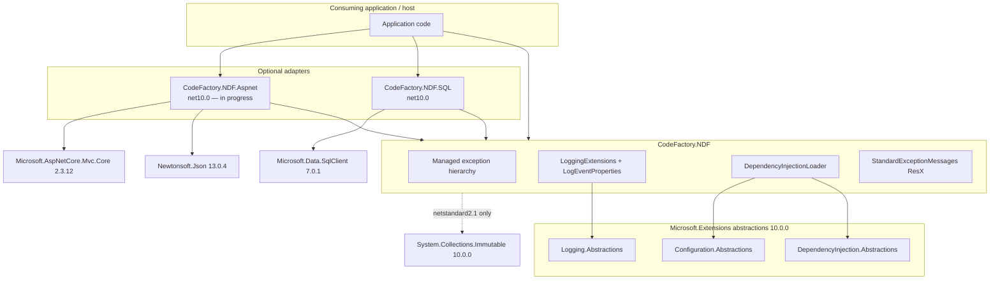
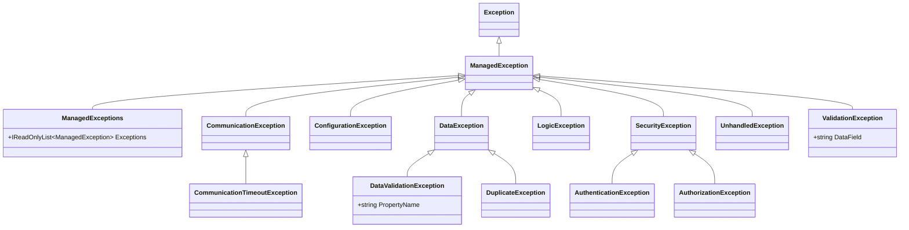
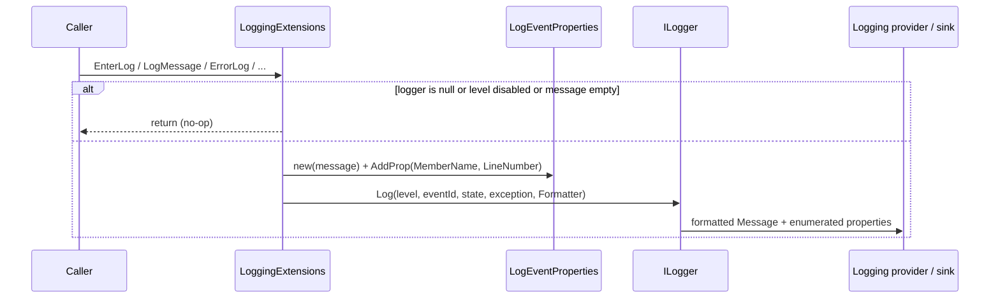
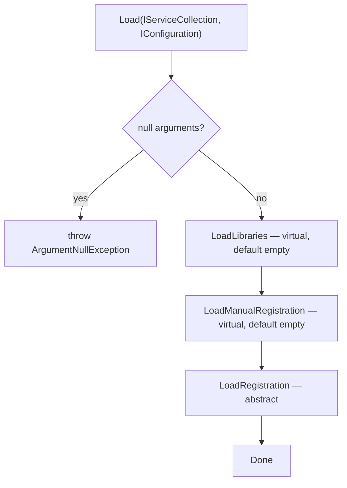

# Net Delivery Framework — Architecture

This document describes the architecture of **NDF-Solution** as it exists today. It is a solution-level view for engineers who consume NDF, maintain it, or add a new adapter library.

Package install instructions live in each project's README. Generated API documentation is published at [https://codefactoryllc.github.io/NDF](https://codefactoryllc.github.io/NDF).

---

## 1. Purpose and scope

**Net Delivery Framework (NDF)** is a family of NuGet class libraries from CodeFactory, LLC. It supplies reusable delivery patterns that consuming .NET solutions compose into their own hosts.

NDF is **not** an application, host, ORM, or data-access layer. It does not own an HTTP pipeline, a SQL connection factory, or a logging sink. Hosts remain responsible for configuration, telemetry providers, and infrastructure.

What NDF *does* provide:

- A **managed exception hierarchy** whose public messages are intended to be application-safe.
- **Structured logging extensions** on `ILogger` that stamp caller member name and line number.
- A **library-level dependency-injection loader** so each library can register itself and its children.
- Optional **adapter libraries** that translate platform-specific failures (today: SQL Server) into that hierarchy.

This file documents the `NDF-Solution` folder. The parent GitHub repository also contains `docs/` and `gendocs/` for the published API site; those are outside this solution.

---

## 2. Solution map

The Visual Studio solution `NDF-Solution.sln` contains three class-library projects and a Solution Items folder (`.editorconfig`).

| Project | NuGet identity | Target frameworks | Package version | Role | Status |
|---|---|---|---|---|---|
| `CodeFactory.NDF` | `CodeFactory.NDF` | `netstandard2.1`, `net10.0` | `10.26141.1` | Core patterns | Shipped |
| `CodeFactory.NDF.SQL` | `CodeFactory.NDF.SQL` | `net10.0` | `10.26141.1` | SQL Server exception translation | Shipped |
| `CodeFactory.NDF.Aspnet` | `CodeFactory.NDF.Aspnet` | `net10.0` | `1.0.0` (SDK default) | Intended ASP.NET integration | Stub (`Class1` only) |

There are no test projects and no shared `Directory.Build.props`. Version, authors, and packaging metadata are duplicated per `.csproj`.

### 2.1 Component diagram



`CodeFactory.NDF.SQL` and `CodeFactory.NDF.Aspnet` both reference core. They do **not** reference each other. Adapters are optional; a host may take core alone.

### 2.2 Target-framework policy

- **Core dual-targets** `netstandard2.1` and `net10.0` so older .NET Core / .NET Standard hosts can still consume the patterns.
- **Adapter libraries target `net10.0` only.** The SQL package release notes state that .NET Standard 2.1 support was removed in the 10.x line.
- On `netstandard2.1`, core additionally references `System.Collections.Immutable` 10.0.0 (used by `ManagedExceptions`). On `net10.0` that type is in the shared framework.

### 2.3 Packaging

| Fact | Core | SQL | Aspnet |
|---|---|---|---|
| SDK-style class library | Yes | Yes | Yes |
| `Nullable` enabled | Yes | Yes | Yes |
| XML documentation file | Yes | Yes | No |
| `GeneratePackageOnBuild` | Yes | Yes | Yes |
| License | MIT (`PackageRequireLicenseAcceptance`) | MIT | Not set |
| README packed | `README.md` | `README.md` | None |
| Package icon | `NDF128.png` | `..\CodeFactory.NDF\NDF128.png` | None |
| Repository URL | `https://github.com/CodeFactoryLLC/NDF` | Same | Not set |
| Package version | `10.26141.1` | `10.26141.1` | `1.0.0` |
| `AssemblyVersion` | `10.0.0.0` | `10.0.0.0` | SDK default |
| `FileVersion` | `10.26141.0.1` | `10.26141.0.1` | SDK default |

Copyright headers in most core/SQL source files still say 2022; `CommunicationTimeoutException` says 2026. Package copyright is 2026.

---

## 3. Design principles

These are the principles the code actually implements.

### 3.1 Safe outer message, rich inner exception

Every managed exception type ships a default message from `StandardExceptionMessages` (a public ResX-generated class). Those strings are written to be shown to an end user. Callers may still pass a custom message.

Every standard type also accepts an optional `internalException`. The original platform exception is preserved for logging and diagnostics; it is not required, and several adapter paths currently omit it (see [§7](#7-sql-adapter-architecture)).

### 3.2 Typed failure categories over raw platform exceptions

Consumers are expected to catch `ManagedException` (or a subclass) rather than `SqlException`, `HttpRequestException`, and similar types. Category is encoded in the type:

| Category | Type family | Typical origin |
|---|---|---|
| Communication | `CommunicationException`, `CommunicationTimeoutException` | Network, SQL connectivity, timeouts |
| Configuration | `ConfigurationException` | Missing/invalid config, cannot open database |
| Data | `DataException`, `DataValidationException`, `DuplicateException` | Persistence, constraints, duplicates |
| Logic | `LogicException` | Application execution errors |
| Security | `SecurityException`, `AuthenticationException`, `AuthorizationException` | Authn / authz / permission |
| Validation | `ValidationException` | Input / domain validation (not necessarily persistence) |
| Unhandled | `UnhandledException` | Catch-all wrap of unexpected exceptions |
| Aggregate | `ManagedExceptions` | Several managed failures raised as one |

### 3.3 Adapter libraries, not a god package

SQL Server types (`Microsoft.Data.SqlClient`) live only in `CodeFactory.NDF.SQL`. ASP.NET types live only in `CodeFactory.NDF.Aspnet`. Core has no knowledge of SQL error numbers or HTTP status codes.

### 3.4 Library-owned dependency injection

`DependencyInjectionLoader` is the extension point for registering services at the library boundary. Child libraries are loaded first, then manual/conditional registrations, then the library's own registrations. Hosts call `Load(IServiceCollection, IConfiguration)` once per root loader.

Neither SQL nor Aspnet currently ships a loader subclass. The pattern is defined in core for consuming solutions and future adapters.

### 3.5 Logging is metadata-rich and sink-agnostic

`LoggingExtensions` depends only on `Microsoft.Extensions.Logging.Abstractions`. There are no Serilog, NLog, or Application Insights types in the library. Member name and line number travel as structured state (`MemberName`, `LineNumber`) so any compatible sink can harvest them.

---

## 4. Managed exception architecture

Namespace: `CodeFactory.NDF`. Base type: `ManagedException : System.Exception`.

### 4.1 Type hierarchy



### 4.2 Constructor contract

Most types expose the same four constructors:

| Constructor | Behavior |
|---|---|
| `()` | Default ResX message, no inner exception |
| `(Exception internalException)` | Default ResX message, inner exception attached |
| `(string message)` | Caller-supplied message |
| `(string message, Exception internalException)` | Caller-supplied message and inner exception |

**`ManagedExceptions`** is different: a single constructor `ManagedExceptions(IEnumerable<ManagedException> managedExceptions)`. The collection is copied to `ImmutableList<ManagedException>`. A null source becomes `ImmutableList<ManagedException>.Empty`. The public `Exceptions` property is `IReadOnlyList<ManagedException>`. The message is always `StandardExceptionMessages.ManagedExceptions`.

**`ValidationException`** adds optional `DataField`:

| Constructor | Notes |
|---|---|
| `(string dataField = null)` | Formats the ResX template with `dataField` |
| `(Exception internalException, string dataField = null)` | Same, with inner exception |
| `(string message, string dataField = null)` | Custom message; `DataField` still stored |
| `(string message, Exception internalException, string dataField = null)` | Custom message + inner + field |

The first constructor is the one `SqlExceptionManagement` hits when it passes a full sentence as the only argument (see [§7.3](#73-constructor-and-message-behavior)).

**`DataValidationException`** requires `propertyName` as the first argument on every constructor. The parameterless-style overload is `(string propertyName)` and formats `StandardExceptionMessages.DataValidationException` with that name. Custom-message overloads are `(propertyName, message)` and `(propertyName, message, internalException)`.

### 4.3 Message catalog

Messages are stored in `StandardExceptionMessages.resx` and exposed by `StandardExceptionMessages` (public, auto-generated). Resource lookups honor `StandardExceptionMessages.Culture`. Only the invariant (English) resources ship in this repository.

| ResX key | Default English string (as stored) | Owning type |
|---|---|---|
| `ManagedException` | An internal application error has occured. | `ManagedException` |
| `ManagedExceptions` | More then one error has occured see the 'Exceptions' for details. | `ManagedExceptions` |
| `CommunicationException` | A communication error has occured within the application. | `CommunicationException` |
| `CommunicationTimeoutException` | A timeout has occured while performing communications within the application. | `CommunicationTimeoutException` |
| `ConfigurationException` | Configuration information for the application could not be found or is invalid. | `ConfigurationException` |
| `DataException` | An internal error occurred, data operation did not complete. | `DataException` |
| `DataValidationException` | A validation error occurred with '{0}'. | `DataValidationException` |
| `DuplicateException` | The information is a duplicate of existing information, the operation could not complete. | `DuplicateException` |
| `LogicException` | The current operation had an internal error. | `LogicException` |
| `SecurityException` | A security error has occurred within the application. | `SecurityException` |
| `AuthenticationException` | Access error has occurred the operation could not complete. | `AuthenticationException` |
| `AuthorizationException` | Access error has occurred the operation could not complete. | `AuthorizationException` |
| `UnhandledException` | An internal application error has occurred. Please confirm the operation completed successfully. | `UnhandledException` |
| `ValidationException` | A validation error has occurred, the data for '{0}' is missing or incomplete. | `ValidationException` |
| `TimeoutException` | The current operation has timed out and could not complete. | **No exception type** |

`TimeoutException` is a leftover resource. The live timeout type is `CommunicationTimeoutException`.

Spelling in the resources (`occured`, `then` vs `than`) is quoted as stored.

### 4.4 Intended consumption

Typical application boundary:

```csharp
try
{
    // operation
}
catch (ManagedException ex)
{
    logger.ErrorLog(ex.Message, ex);
    throw;
}
catch (Exception ex)
{
    logger.ErrorLog(ex.Message, ex);
    throw new UnhandledException(ex);
}
```

Multi-step or multi-field validation can accumulate `ManagedException` instances and throw a single `ManagedExceptions`. Callers inspect `Exceptions` rather than parsing a combined message.

`UnhandledException` is the designated wrap for failures that were not already in the managed hierarchy. Its default message asks the user to confirm the operation completed, because the original work may have partially succeeded.

---

## 5. Structured logging architecture

### 5.1 Types

| Type | Role |
|---|---|
| `LoggingExtensions` | Static `ILogger` extensions. Constants `PropertyMemberName` (`"MemberName"`) and `PropertyLineNumber` (`"LineNumber"`). |
| `LogEventProperties` | Log-event state: a message plus a list of `KeyValuePair<string, object>`. Implements `IEnumerable<KeyValuePair<string, object>>` so Microsoft.Extensions.Logging structured providers can enumerate properties. |

`LogEventProperties.Formatter` is `Func<LogEventProperties, Exception?, string>` and returns `l.Message` only. Properties travel as **state**, not as part of the formatted string.

### 5.2 API surface

About 56 public methods, in three families.

**Generic (caller supplies `LogLevel`):**

- `EnterLog(level)` / `EnterLog(level, eventId)`
- `ExitLog(level)` / `ExitLog(level, eventId)`
- `LogMessage(level, message)` / `LogMessage(level, message, eventId)` / `LogMessage(level, message, exception)` / `LogMessage(level, message, exception, eventId)`

**Level-specific shortcuts** for Trace, Debug, Information, Warning, Error, and Critical:

- `{Level}EnterLog` / `{Level}EnterLog(eventId)`
- `{Level}ExitLog` / `{Level}ExitLog(eventId)`
- `{Level}Log(message)` / `{Level}Log(message, eventId)` / `{Level}Log(message, exception)` / `{Level}Log(message, exception, eventId)`

Every method takes `[CallerMemberName] string memberName = null` and `[CallerLineNumber] int lineNumber = 0`. File path is **not** captured.

Enter/exit messages are `Entering '{memberName}'` and `Exiting '{memberName}'`.

### 5.3 Guard and write path



Guards, in order:

1. `source == null` → return (no throw).
2. `!source.IsEnabled(level)` → return.
3. For message APIs: `string.IsNullOrEmpty(message)` → return.

Enter/exit APIs skip the empty-message check because the message is generated.

`DefaultEventId` is `default(EventId)` when the caller does not supply one.

### 5.4 Host usage

Hosts still configure their own logging providers (`AddLogging`, Serilog, Application Insights, and so on). NDF only adds caller metadata. Example:

```csharp
public async Task ProcessOrderAsync(int orderId)
{
    _logger.EnterLog(LogLevel.Debug);
    try
    {
        // ...
    }
    catch (ManagedException ex)
    {
        _logger.ErrorLog(ex.Message, ex);
        throw;
    }
    finally
    {
        _logger.ExitLog(LogLevel.Debug);
    }
}
```

---

## 6. Dependency injection loader

`DependencyInjectionLoader` is an abstract class in `CodeFactory.NDF`. It is a template method for library-level registration.

### 6.1 Load pipeline



Order is intentional: **children first**, then **manual/conditional**, then **this library**. A parent can therefore override a child's registration after the child has loaded.

| Method | Required | Default | Purpose |
|---|---|---|---|
| `Load` | Public entry | Implemented | Null-checks, then the three phases |
| `LoadLibraries` | Override as needed | Empty | `new ChildLoader().Load(services, configuration)` |
| `LoadManualRegistration` | Override as needed | Empty | Factories, options, environment-specific wiring |
| `LoadRegistration` | Must override | Abstract | This library's `AddScoped` / `AddSingleton` / etc. |

`Load` throws `ArgumentNullException` if `serviceCollection` or `configuration` is null. It does **not** use the managed exception hierarchy for those argument checks.

### 6.2 Host composition

```csharp
public class OrdersLibraryLoader : DependencyInjectionLoader
{
    protected override void LoadLibraries(IServiceCollection services, IConfiguration configuration)
    {
        new PersistenceLibraryLoader().Load(services, configuration);
    }

    protected override void LoadRegistration(IServiceCollection services, IConfiguration configuration)
    {
        services.AddScoped<IOrderService, OrderService>();
    }
}

// Host startup
new OrdersLibraryLoader().Load(builder.Services, builder.Configuration);
```

There is no assembly-scanning or `IHostingStartup` hook. Composition is explicit.

---

## 7. SQL adapter architecture

Project: `CodeFactory.NDF.SQL`. Namespace: `CodeFactory.NDF.SQL`. Single public type: static class `SqlExceptionManagement`.

The adapter's job is to turn `Microsoft.Data.SqlClient.SqlException` into a managed exception with an application-safe message. It does not open connections, execute commands, or retry.

### 7.1 Public contract

- **Error number constants** — `public const int` for each mapped SQL number (e.g. `TimeoutNumber = -2`, `DeadlockNumber = 1205`).
- **Message constants** — `public const string` companions (e.g. `TimeoutMessage`, `DeadlockMessage`).
- **`ThrowManagedException(this SqlException source)`** — evaluates `source.Number` and throws. The method always throws (or throws `ValidationException` if `source` is null); it never returns.

Null source:

```csharp
if (source == null) throw new ValidationException(nameof(source));
```

That uses the `ValidationException(string dataField)` constructor, so `DataField` is `"source"`.

### 7.2 Error-number mapping

Implementation in `ThrowManagedException`:

| SQL number | Constant | Condition | Exception thrown | Message actually passed | Inner `SqlException` |
|---|---|---|---|---|---|
| 18456 | `AuthenticationErrorNumber` | Login failed | `AuthenticationException` | `AuthenticationErrorMessage` | No |
| 18470 | `AccountDisabledNumber` | Account disabled | `AuthenticationException` | `AuthenticationErrorMessage` (not `AccountDisabledMessage`) | No |
| 229 | `PermissionDeniedNumber` | Object permission denied | `AuthorizationException` | `PermissionDeniedMessage` | No |
| 230 | `ColumnPermissionDeniedNumber` | Column permission denied | `AuthorizationException` | `PermissionDeniedMessage` (not `ColumnPermissionDeniedMessage`) | No |
| 262 | `CreatePermissionDeniedNumber` | CREATE permission denied | `AuthorizationException` | `PermissionDeniedMessage` (not `CreatePermissionDeniedMessage`) | No |
| 10060 | `ConnectionFailureNumber` | Connection failure | `CommunicationException` | `ConnectionFailureMessage` | No |
| 53 | `NetworkPathNotFoundNumber` | Network path not found | `CommunicationException` | `ConnectionFailureMessage` (not `NetworkPathNotFoundMessage`) | No |
| 10054 | `ConnectionResetNumber` | Connection reset | `CommunicationException` | `ConnectionFailureMessage` (not `ConnectionResetMessage`) | No |
| -2 | `TimeoutNumber` | Command/connection timeout | `CommunicationTimeoutException` | `TimeoutMessage` | No |
| 4060 | `CannotOpenDatabaseNumber` | Cannot open database | `ConfigurationException` | `CannotOpenDatabaseMessage` | No |
| 2601 | `DuplicateEntryNumber` | Duplicate key (index) | `DuplicateException` | `DuplicateEntryMessage` | No |
| 2627 | `UniqueKeyConstraintViolationNumber` | Unique constraint | `DuplicateException` | `KeyConstraintEntryMessage` | No |
| 515 | `CannotInsertNullNumber` | NULL into non-nullable | `DataValidationException` | See [§7.3](#73-constructor-and-message-behavior) | No |
| 8152 | `DataTruncationNumber` | Data truncation | `DataValidationException` | Same as 515 (`CannotInsertNullMessage`) | No |
| 547 | `ForeignKeyConstraintNumber` | Foreign key violation | `ValidationException` | See [§7.3](#73-constructor-and-message-behavior) | No |
| 1205 | `DeadlockNumber` | Deadlock victim | `DataException` | `DeadlockMessage` | **Yes** |
| *(any other)* | — | Unknown | `DataException` | `source.Message` (SQL text) | **Yes** |

Message constants defined on the type (verbatim):

| Constant | String |
|---|---|
| `ConnectionFailureMessage` | System was not able to connect to the source cannot access data. |
| `NetworkPathNotFoundMessage` | The system was not able to locate the data source on the network. |
| `ConnectionResetMessage` | The connection to the data source was unexpectedly closed. |
| `TimeoutMessage` | The system timed out accessing the data. |
| `AuthenticationErrorMessage` | Was not able to access the data source due to an internal error. |
| `AccountDisabledMessage` | Access to the data source has been disabled. |
| `PermissionDeniedMessage` | Access to the requested data is not permitted. |
| `ColumnPermissionDeniedMessage` | Access to a required data field is not permitted. |
| `CreatePermissionDeniedMessage` | The system does not have permission to perform this operation on the data source. |
| `CannotOpenDatabaseMessage` | The system was unable to open the target data source. Please verify configuration settings. |
| `CannotInsertNullMessage` | A required data field was not provided. |
| `ForeignKeyConstraintMessage` | The data references related information that does not exist in the system. |
| `DataTruncationMessage` | A data field value exceeds the maximum allowed length. |
| `DeadlockMessage` | A data conflict was detected, please try your request again. |
| `DuplicateEntryMessage` | A duplicate copy of the data was found in storage, the system does not support duplicate copies of data. |
| `KeyConstraintEntryMessage` | A key for the data that is being added was found in storage, the system does not support duplicate copies of key data. |

Several of those message constants are unused by the switch; grouped cases share one message.

### 7.3 Constructor and message behavior

Two mappings do not hit a `(string message)` constructor:

**515 / 8152 — `new DataValidationException(CannotInsertNullMessage)`**

`DataValidationException(string propertyName)` treats the argument as a property name and formats `StandardExceptionMessages.DataValidationException`. Live result:

- `PropertyName` = `"A required data field was not provided."`
- `Message` = `"A validation error occurred with 'A required data field was not provided.'."`

`DataTruncationMessage` is not used.

**547 — `new ValidationException(ForeignKeyConstraintMessage)`**

`ValidationException(string dataField = null)` treats the argument as a field name. Live result:

- `DataField` = `"The data references related information that does not exist in the system."`
- `Message` = `"A validation error has occurred, the data for 'The data references related information that does not exist in the system.' is missing or incomplete."`

These are the live contracts, not README approximations.

### 7.4 Intended data-layer usage

```csharp
using CodeFactory.NDF.SQL;
using Microsoft.Data.SqlClient;

try
{
    // SQL work
}
catch (SqlException ex)
{
    ex.ThrowManagedException();
}
```

The SQL README currently shows `using System.Data.SqlClient`; the project references `Microsoft.Data.SqlClient` 7.0.1. The extension is defined on `Microsoft.Data.SqlClient.SqlException`.

The adapter does not catch exceptions for the caller. It only translates. Retry (for example on deadlock 1205) remains a host concern.

---

## 8. ASP.NET adapter (current state)

`CodeFactory.NDF.Aspnet` is on the solution's `AspNetLibrary` branch and is **not implemented**.

| Item | Current state |
|---|---|
| Source | `Class1` in namespace `CodeFactory.NDF.Aspnet` — empty |
| Target | `net10.0` |
| Project reference | `CodeFactory.NDF` |
| Package references | `Microsoft.AspNetCore.Mvc.Core` 2.3.12, `Newtonsoft.Json` 13.0.4 |
| README / license / icon / repo URL | Not set |
| Package version | SDK default `1.0.0` (not aligned with `10.26141.1`) |
| Implicit usings | Enabled (unlike core/SQL) |

`Microsoft.AspNetCore.Mvc.Core` 2.3.12 is the ASP.NET Core **2.x** MVC package, referenced from a `net10.0` project. That is the current packaging choice; it is not a completed integration design.

The package set (MVC core + JSON) indicates an intended **HTTP-edge mapping** of `ManagedException` types (filters, middleware, or equivalent), analogous to how SQL maps `SqlException.Number`. No filter, middleware, status-code table, or ProblemDetails contract exists in source, so this document does not invent one.

---

## 9. Packaging, versioning, and build

### 9.1 Version scheme (core and SQL)

| Field | Value |
|---|---|
| Package / `<Version>` | `10.26141.1` |
| `<AssemblyVersion>` | `10.0.0.0` |
| `<FileVersion>` | `10.26141.0.1` |

The leading `10` tracks the .NET 10 line. The remaining digits follow CodeFactory's package numbering, not SemVer minor/patch in the usual sense.

### 9.2 Build behavior

- SDK-style `Microsoft.NET.Sdk` class libraries.
- `GeneratePackageOnBuild` is true on all three projects, so a Debug/Release build produces `.nupkg` under each project's `bin` folder.
- Core and SQL generate XML documentation (`GenerateDocumentationFile`).
- `.editorconfig` applies to `*.cs` and sets `dotnet_diagnostic.CS0162.severity = silent` (unreachable code).

### 9.3 Shared assets

- Icon `CodeFactory.NDF/NDF128.png` is packed by core and reused by SQL via a relative `None` include.
- Exception strings: `StandardExceptionMessages.resx` → `PublicResXFileCodeGenerator` → `StandardExceptionMessages.Designer.cs`.

---

## 10. Runtime composition

How a typical host that uses both core and SQL is expected to run. The ASP.NET adapter is omitted because it has no runtime types yet.

```mermaid
sequenceDiagram
    participant Host as Host Program
    participant Loader as DependencyInjectionLoader
    participant App as Application / domain
    participant Data as Data access
    participant SQL as SqlExceptionManagement
    participant Log as ILogger via LoggingExtensions

    Host->>Loader: Load(services, configuration)
    Loader->>Loader: LoadLibraries → LoadManualRegistration → LoadRegistration
    Host->>App: handle request
    App->>Log: EnterLog
    App->>Data: persist / query
    alt SQL error
        Data->>SQL: catch SqlException; ThrowManagedException()
        SQL-->>App: throw ManagedException subclass
        App->>Log: ErrorLog(message, exception)
        App-->>Host: propagate managed exception
    else success
        Data-->>App: result
        App->>Log: ExitLog
        App-->>Host: result
    end
    Note over App,Host: Unknown Exception is wrapped as UnhandledException at the boundary
```

Recommended layering in the consuming solution:

1. **Host** — build configuration and logging; call the root `DependencyInjectionLoader`.
2. **Application / domain** — throw `ValidationException`, `LogicException`, `ManagedExceptions` as appropriate; log with NDF extensions.
3. **Data access** — catch platform exceptions (`SqlException`) and translate via the matching adapter; do not leak platform types above this layer.
4. **HTTP / UI edge** — catch `ManagedException` and present `Message` (and, when useful, `DataField` / `PropertyName` / `Exceptions`). Until the ASP.NET adapter exists, that mapping is host-owned.

---

## 11. Extension points

Adding another adapter (HTTP client, Cosmos DB, gRPC, and so on) should follow the SQL shape:

1. New class-library project referencing `CodeFactory.NDF`.
2. Keep platform types (`HttpRequestException`, Cosmos SDK, …) out of core.
3. Map platform failures onto the existing hierarchy. Introduce a new subclass only when no existing category fits.
4. Prefer application-safe messages; chain the platform exception as `internalException` when diagnostics matter.
5. Optionally add a `DependencyInjectionLoader` subclass if the adapter registers services.
6. Target `net10.0` unless there is a concrete reason to dual-target. Dual-target only if the adapter's platform package supports it (SQL dropped `netstandard2.1` in 10.x).
7. Align package version, license, icon, README, and repository metadata with core/SQL if the library is published.

Do not put adapter-specific error numbers or HTTP status codes into `CodeFactory.NDF`.

---

## 12. Current-state caveats

Factual gaps so this document does not over-claim. They are not a commitment to change in this file.

| Area | Fact |
|---|---|
| Tests | No test projects in `NDF-Solution`. |
| ASP.NET | `CodeFactory.NDF.Aspnet` is a stub with incomplete package metadata. |
| ResX | `TimeoutException` resource has no corresponding type. |
| SQL default branch | Unknown SQL errors throw `DataException(source.Message, source)`, which surfaces SQL Server's own text — not the application-safe default. |
| SQL inner exceptions | Only deadlock and the default branch attach the original `SqlException`. Mapped cases do not. |
| SQL constructors | 515/8152 and 547 do not use the custom-message constructors; see [§7.3](#73-constructor-and-message-behavior). |
| SQL unused messages | Several message constants (`AccountDisabledMessage`, `NetworkPathNotFoundMessage`, `DataTruncationMessage`, …) are not selected by the switch. |
| SQL README | Example still imports `System.Data.SqlClient`; implementation uses `Microsoft.Data.SqlClient`. |
| Core README | Exception table omits `CommunicationTimeoutException`. |
| Shared build | No `Directory.Build.props`; version and packaging settings are duplicated. |
| Aspnet package ref | `Microsoft.AspNetCore.Mvc.Core` 2.3.12 is an ASP.NET Core 2.x package on `net10.0`. |

---

## Related files

| Path | What it is |
|---|---|
| `NDF-Solution.sln` | Solution (core, SQL, Aspnet, `.editorconfig`) |
| `CodeFactory.NDF/README.md` | Core package README (install, feature overview) |
| `CodeFactory.NDF.SQL/README.md` | SQL package README (install, mapping table) |
| `CodeFactory.NDF/*.cs` | Core types documented in [§4](#4-managed-exception-architecture)–[§6](#6-dependency-injection-loader) |
| `CodeFactory.NDF.SQL/SqlExceptionManagement.cs` | SQL translation documented in [§7](#7-sql-adapter-architecture) |
| `CodeFactory.NDF.Aspnet/Class1.cs` | ASP.NET placeholder |
| [https://github.com/CodeFactoryLLC/NDF](https://github.com/CodeFactoryLLC/NDF) | Source repository |
| [https://codefactoryllc.github.io/NDF](https://codefactoryllc.github.io/NDF) | Generated API documentation |
